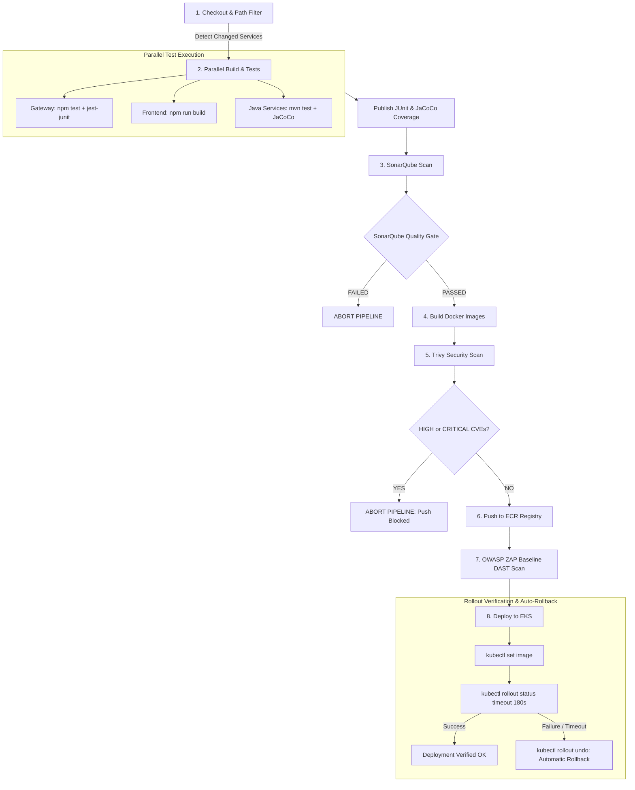

# TwinDigital CI/CD Pipeline Setup & Operations Guide

This guide documents the enterprise-grade, declarative CI/CD pipeline defined in [`Jenkinsfile`](../Jenkinsfile), the lightweight infrastructure setup in [`ci/docker-compose.yml`](./docker-compose.yml), and the security gates governing automated delivery to Amazon EKS.

---

## 1. Pipeline Architecture & Workflow



---

## 2. Running Jenkins & SonarQube Cheaply

The stack can be spun up on a single modest machine (e.g., an AWS EC2 `t3.medium` or `t3.large`, 4GB–8GB RAM) using Docker Compose.

### Quickstart Command
```bash
# Navigate to the ci directory
cd ci

# Start PostgreSQL, SonarQube, and Jenkins in the background
docker-compose up -d

# Verify containers are healthy
docker-compose ps
```

### Access URLs & Default Credentials
| Service | URL | Default Credentials | Memory Allocation |
| :--- | :--- | :--- | :--- |
| **Jenkins** | `http://localhost:8088` | Setup token in `docker logs twindigital-jenkins` | Max 1.5 GB |
| **SonarQube** | `http://localhost:9000` | Username: `admin` / Password: `admin` | Max 1.2 GB (tuned) |
| **PostgreSQL** | `localhost:5432` (internal) | User: `sonar` / Pass: `SonarSecurePassword123!` | Max 256 MB |

> [!TIP]
> **Elasticsearch Memory Tuning**: SonarQube's embedded Elasticsearch has been tuned with `ES_JAVA_OPTS=-Xms512m -Xmx512m` and `SONAR_SEARCH_JAVAADDITIONALOPTS=-Xms512m -Xmx512m` in [`ci/docker-compose.yml`](./docker-compose.yml). This prevents out-of-memory crashes on low-cost virtual machines.

---

## 3. Jenkins Configuration & Plugins

### Required Jenkins Plugins
Install the following plugins via **Manage Jenkins $\rightarrow$ Plugins $\rightarrow$ Available Plugins**:
1. **Pipeline** (`workflow-aggregator`)
2. **SonarQube Scanner** (`sonar`)
3. **JaCoCo plugin** (`jacoco`)
4. **Docker Pipeline** (`docker-workflow`)
5. **Kubernetes CLI** (`kubernetes-cli`)
6. **HTML Publisher** (`htmlpublisher`)
7. **AnsiColor** (`ansicolor`)

---

## 4. Configuring Jenkins Credentials Store

Navigate to **Manage Jenkins $\rightarrow$ Credentials $\rightarrow$ System $\rightarrow$ Global credentials**:

| Credential ID | Type | Description | Usage in Pipeline |
| :--- | :--- | :--- | :--- |
| `sonarqube-token` | **Secret text** | SonarQube User Token (generated in SonarQube UI) | Authenticating scanner and querying Quality Gate |
| `aws-ecr-credentials` | **AWS Credentials** or **Username with password** | AWS Access Key / Secret Key with ECR push permissions | Logging into ECR via `aws ecr get-login-password` |
| `eks-kubeconfig` | **Secret file** | `kubeconfig` YAML file for the target EKS cluster | Authenticating `kubectl` during deployment |

---

## 5. SonarQube Webhook & Quality Gate Setup

To enable the `waitForQualityGate()` pipeline step to receive asynchronous webhook callbacks:

1. In SonarQube (`http://localhost:9000`), log in as `admin`.
2. Go to **Administration $\rightarrow$ Configuration $\rightarrow$ Webhooks $\rightarrow$ Create**:
   - **Name**: `Jenkins Webhook`
   - **URL**: `http://twindigital-jenkins:8080/sonarqube-webhook/` (or `http://<JENKINS_HOST>:8088/sonarqube-webhook/`)
3. Go to **Quality Gates**:
   - Set conditions:
     - Coverage on New Code $\ge$ 80%
     - Duplicated Lines on New Code $\le$ 3%
     - Security Rating is A (0 vulnerabilities)
     - Reliability Rating is A (0 bugs)

---

## 6. Pipeline Stages Walkthrough

### Stage 1: Checkout & Path Filtering
- Computes the 7-character short commit SHA (`git rev-parse --short HEAD`).
- Compares files modified in the commit (`git diff --name-only HEAD~1 HEAD`):
  - Changes to `gateway/` mark `gateway` for build.
  - Changes to `frontend/` mark `frontend` for build.
  - Changes to `services/<svc>/` mark that microservice for build.
  - Changes to shared configs (`k8s/`, `ci/`, `Jenkinsfile`) trigger a full build matrix.
- Users can override auto-detection using the `TARGET_SERVICE` parameter (`all` or specific service).

### Stage 2: Parallel Build & Unit Tests
- Executes independent builds concurrently using `parallel`:
  - **Gateway**: `npm test -- --reporters=default --reporters=jest-junit --coverage`
  - **Frontend**: `npm run build`
  - **Java Services**: `mvn clean org.jacoco:jacoco-maven-plugin:prepare-agent test org.jacoco:jacoco-maven-plugin:report package`
- **Report Publishing**: Automatically indexes JUnit test results and publishes JaCoCo coverage metrics.

### Stage 3: SonarQube Static Analysis & Quality Gate
- Scans source code and connects JaCoCo XML reports.
- Pauses the pipeline up to 5 minutes waiting for SonarQube Quality Gate webhook callback.
- **Fail-Closed Behavior**: If Quality Gate status is not `OK`, the pipeline throws an unhandled error, immediately terminating execution and preventing Docker image creation.

### Stage 4: Docker Image Build
- Tags images with two standard conventions:
  - `<REGISTRY>/<service>:<GIT_SHORT_SHA>` (Immutable traceability)
  - `<REGISTRY>/<service>:latest`

### Stage 5: Trivy Container Image Security Scan
- Executes vulnerability scanning with `--severity HIGH,CRITICAL`.
- Generates human-readable table reports and machine-readable JSON artifacts.
- **Security Gate Enforcement**: Running with `--exit-code 1` causes Trivy to fail the stage if any unresolved HIGH or CRITICAL vulnerabilities are discovered, blocking push and deployment.

### Stage 6: Push to Container Registry
- Only reached if SonarQube and Trivy scans succeed.
- Logs into Amazon ECR using AWS credentials and pushes the image tags.

### Stage 7: OWASP ZAP Baseline DAST Scan
- Runs against the staging URL (`http://staging.twindigital.io`) using the official `zaproxy/zap-stable` container.
- Publishes interactive HTML vulnerability reports in the Jenkins build view.

### Stage 8: Deploy to EKS with Automatic Rollback
- Executes `kubectl set image deployment/<service> <service>=<imageTag> -n twindigital`.
- Waits up to 180 seconds for `kubectl rollout status`.
- **Automatic Rollback**: If the rollout fails (e.g. `CrashLoopBackOff`, failed liveness probe, or timeout), the pipeline catches the exception, issues `kubectl rollout undo deployment/<service>`, verifies cluster recovery, and fails the build.

---

## 7. Verifying Pipeline Operations

### Testing Rollout Failure & Automatic Rollback
To verify automatic rollback in an ephemeral test environment:
```bash
# Intentionally point deployment to an invalid image tag
kubectl set image deployment/gateway gateway=twindigital/gateway:invalid-tag-test -n twindigital

# Observe Jenkins or run rollout status check
kubectl rollout status deployment/gateway -n twindigital --timeout=30s
# Fails with ImagePullBackOff

# Execute rollback command executed by Jenkins pipeline
kubectl rollout undo deployment/gateway -n twindigital
kubectl rollout status deployment/gateway -n twindigital
# Status returns to successfully rolled out
```

### Reviewing Archived Reports in Jenkins UI
Every build automatically archives:
1. **JUnit Test Results**: Accessible via the build status page.
2. **JaCoCo Coverage**: Visualized on the build trend graph.
3. **Trivy Vulnerability Reports**: Stored in `scan-reports/trivy-*.json` and `.txt`.
4. **OWASP ZAP DAST Report**: Interactive report under **OWASP ZAP DAST Report** on the Jenkins left menu.
