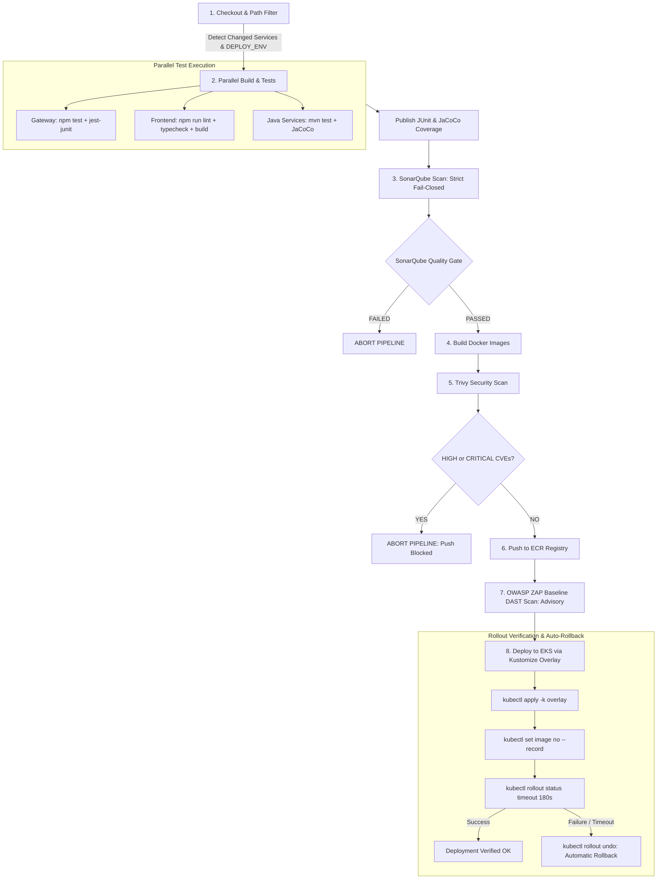

# TwinDigital CI/CD Pipeline Setup & Operations Guide

This guide documents the enterprise-grade, declarative CI/CD pipeline defined in [`Jenkinsfile`](../Jenkinsfile), the custom Jenkins agent image in [`ci/agent/Dockerfile`](./agent/Dockerfile), the lightweight infrastructure setup in [`ci/docker-compose.yml`](./docker-compose.yml), and the Helm configurations for Kubernetes deployment.

---

## 1. Pipeline Architecture & Workflow



---

## 2. Dedicated Jenkins Agent Image

The pipeline runs inside a standardized Docker agent image defined in [`ci/agent/Dockerfile`](./agent/Dockerfile) instead of `agent any`. This ensures consistent execution across all build, test, and security stages without tool discrepancies.

### Installed Tooling & Versions
| Tool | Version / Details | Purpose |
| :--- | :--- | :--- |
| **OpenJDK** | 17 (Ubuntu 22.04 LTS) | Microservice compilation and JaCoCo coverage analysis |
| **Maven** | 3.9+ | Spring Boot build lifecycle and surefire testing |
| **Node.js & npm** | Node.js 20.x, npm latest | Gateway tests and Frontend lint, typecheck, & Vite build |
| **Trivy** | Latest stable | Container image vulnerability scanner (HIGH/CRITICAL gate) |
| **kubectl** | v1.29.3 | Cluster orchestration, Kustomize apply, and rollout verification |
| **AWS CLI** | v2 | ECR authentication (`aws ecr get-login-password`) and AWS API calls |
| **Sonar-Scanner** | 5.0.1+ | Static code analysis and SonarQube Quality Gate submission |
| **Docker CLI** | Latest CE CLI | Building and pushing container images via `/var/run/docker.sock` |

### Building and Registering the Agent Image
```bash
# Build the agent image locally or push to Amazon ECR:
docker build -t twindigital/jenkins-agent:latest -f ci/agent/Dockerfile ci/agent/

# Tag and push to Amazon ECR (if running distributed Jenkins nodes):
docker tag twindigital/jenkins-agent:latest 112233445566.dkr.ecr.ap-south-1.amazonaws.com/twindigital/jenkins-agent:latest
docker push 112233445566.dkr.ecr.ap-south-1.amazonaws.com/twindigital/jenkins-agent:latest
```

---

## 3. Running Jenkins & SonarQube Cheaply (Docker Compose)

The CI/CD stack can be hosted on a single machine (e.g., an AWS EC2 `t3.medium` or `t3.large`, 4GB–8GB RAM) using Docker Compose.

### Quickstart Setup
1. Copy the example environment template and configure secrets:
   ```bash
   cd ci
   cp .env.example .env
   # Edit .env and supply a strong password for SONAR_DB_PASSWORD
   ```
2. Start PostgreSQL, SonarQube, and Jenkins in the background:
   ```bash
   docker-compose up -d
   ```
3. Verify containers are healthy:
   ```bash
   docker-compose ps
   ```

### Access URLs & Credentials
| Service | URL | Authentication | Memory Allocation |
| :--- | :--- | :--- | :--- |
| **Jenkins** | `http://localhost:8088` | Setup token in `docker logs twindigital-jenkins` | Max 1.5 GB |
| **SonarQube** | `http://localhost:9000` | Username: `admin` / Password: `admin` | Max 1.2 GB (tuned) |
| **PostgreSQL** | `localhost:5432` (internal) | User: `${SONAR_DB_USER}` / Pass: `${SONAR_DB_PASSWORD}` | Max 256 MB |

> [!TIP]
> **No Hardcoded Passwords**: All PostgreSQL and SonarQube database credentials in [`ci/docker-compose.yml`](./docker-compose.yml) are injected via `${SONAR_DB_PASSWORD}` and `${SONAR_DB_USER}` environment variables defined in `ci/.env`.

---

## 4. Kubernetes Helm Deployment (Cost-Optimized Values)

For running Jenkins and SonarQube directly inside an EKS cluster on `t3.medium` nodes, use the dedicated, valid Helm values files:

### 1. Jenkins Helm Installation
```bash
helm repo add jenkins https://charts.jenkins.io
helm repo update

helm upgrade --install jenkins jenkins/jenkins \
  --namespace ci \
  --create-namespace \
  -f ci/helm-jenkins-values.yaml
```

### 2. SonarQube Helm Installation
```bash
helm repo add sonarqube https://SonarSource.github.io/helm-chart-sonarqube
helm repo update

helm upgrade --install sonarqube sonarqube/sonarqube \
  --namespace ci \
  --create-namespace \
  -f ci/helm-sonarqube-values.yaml
```

---

## 5. Required Jenkins Credentials

Navigate to **Manage Jenkins $\rightarrow$ Credentials $\rightarrow$ System $\rightarrow$ Global credentials**:

| Credential ID | Type | Description | Usage in Pipeline |
| :--- | :--- | :--- | :--- |
| `sonarqube-token` | **Secret text** | SonarQube User Token (generated in SonarQube UI) | Authenticating scanner and querying Quality Gate |
| `aws-ecr-credentials` | **AWS Credentials** | AWS Access Key / Secret Key with ECR push permissions | Logging into ECR via `aws ecr get-login-password` |
| `eks-kubeconfig` | **Secret file** | `kubeconfig` YAML file for the target EKS cluster | Authenticating `kubectl` during deployment |

---

## 6. Pipeline Stages Walkthrough

### Stage 1: Checkout, Path Filtering, & Environment Selection
- Computes the 7-character short commit SHA (`git rev-parse --short HEAD`).
- Compares files modified in the commit (`git diff --name-only HEAD~1 HEAD`):
  - Changes to `gateway/` mark `gateway` for build.
  - Changes to `frontend/` mark `frontend` for build.
  - Changes to `services/<svc>/` mark that microservice for build.
  - Changes to root configs (`k8s/`, `ci/`, `Jenkinsfile`) trigger a full build matrix.
- **Environment Selection**: The `DEPLOY_ENV` pipeline parameter dynamically maps to:
  - `staging`: Overlay `k8s/overlays/staging`, Namespace `twindigital-staging`
  - `prod`: Overlay `k8s/overlays/prod`, Namespace `twindigital-prod`

### Stage 2: Parallel Build & Unit Tests
- **Gateway**: `npm test -- --reporters=default --reporters=jest-junit --coverage`
- **Frontend**: Runs `npm run lint` (`oxlint`), `npm run typecheck` (`tsc --noEmit`), and `npm run build` (`vite build`).
- **Java Microservices**: `mvn clean org.jacoco:jacoco-maven-plugin:prepare-agent test org.jacoco:jacoco-maven-plugin:report package`.
- Publishes JUnit XML test results and JaCoCo coverage trends.

### Stage 3: SonarQube Static Analysis & Quality Gate
- Scans source code and connects JaCoCo XML reports.
- **Strict Execution**: The Gateway Sonar step executes strictly without `|| true`; any scanner execution failure fails the build immediately.
- Enforces SonarQube Quality Gate check via `waitForQualityGate()`.

### Stage 4: Docker Image Build
- Builds container images tagged with both the git commit SHA and `latest`.

### Stage 5: Trivy Container Image Security Scan
- Scans built images for HIGH and CRITICAL vulnerabilities.
- Enforces an automated gate (`--exit-code 1`), blocking image push and deployment if vulnerabilities are found.

### Stage 6: Push to Container Registry
- Authenticates with Amazon ECR via `aws ecr get-login-password` and pushes image tags.

### Stage 7: OWASP ZAP Baseline DAST Scan (Advisory)
- Executes an automated DAST baseline scan against `${STAGING_URL}` using the `zaproxy/zap-stable` container.
- **Non-blocking Advisory Rationale**: ZAP baseline scans flag passive informational and header warnings. The scan runs with `|| true` to ensure HTML and JSON reports are generated and published without halting delivery pipelines.

### Stage 8: Deploy to EKS with Automatic Rollback
- Applies the selected Kustomize overlay:
  ```bash
  kubectl apply -k ${OVERLAY_DIR} --namespace=${K8S_NAMESPACE}
  ```
- Updates deployment images:
  ```bash
  kubectl set image deployment/${svc} ${svc}=${imageTag} --namespace=${K8S_NAMESPACE}
  ```
  *(Note: The deprecated `--record` flag has been removed).*
- Monitors rollout status with `kubectl rollout status --timeout=180s`.
- **Automatic Rollback**: If a deployment fails or times out, the pipeline executes `kubectl rollout undo deployment/${svc}`, verifies cluster stability, and aborts the pipeline.
