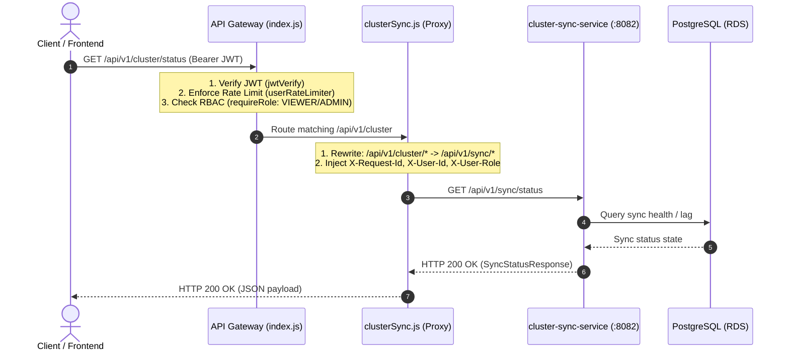

# Cluster Sync Proxy Route (`gateway/src/routes/clusterSync.js`)

`clusterSync.js` is an Express router module within the **TwinDigital API Gateway** that serves as an authenticated, resilient reverse proxy for all cluster synchronization and state-monitoring operations provided by the downstream **`cluster-sync-service`** (`:8082`).

---

## 1. Architectural Role & Responsibilities

In the TwinDigital platform, the frontend and external clients never communicate directly with internal microservices. Instead, the API Gateway terminates public connections, validates authentication tokens, checks role permissions, and securely routes requests downstream.



---

## 2. Core Implementation Details

### Source Code
[`gateway/src/routes/clusterSync.js`](file:///c:/Users/adity/OneDrive/Desktop/cloudca/gateway/src/routes/clusterSync.js):

```javascript
'use strict';

const { Router } = require('express');
const { createProxyMiddleware } = require('http-proxy-middleware');
const { sendError } = require('../utils/errorResponse');

const router = Router();
const target = process.env.CLUSTER_SYNC_SERVICE_URL || 'http://localhost:8082';

const proxy = createProxyMiddleware({
  target,
  changeOrigin: true,
  pathRewrite: { '^/api/v1/cluster': '/api/v1/sync' },
  on: {
    proxyReq: (proxyReq, req) => {
      if (req.id) {
        proxyReq.setHeader('X-Request-Id', req.id);
      }
      if (req.user) {
        proxyReq.setHeader('X-User-Id', req.user.sub || '');
        proxyReq.setHeader('X-User-Role', req.user.role || '');
      }
    },
    error: (err, req, res) => {
      sendError(res, 502, 'Bad Gateway', `cluster-sync-service unavailable: ${err.message}`, req);
    },
  },
});

router.use('/', proxy);

module.exports = router;
```

---

## 3. Key Features

### 1. Dynamic Downstream Target Resolution
- Reads the downstream service address from `process.env.CLUSTER_SYNC_SERVICE_URL`.
- Falls back to `http://localhost:8082` for local development outside Kubernetes.
- In Kubernetes, points to `http://cluster-sync-service.twindigital.svc.cluster.local:8082`.

### 2. Path Rewriting (`pathRewrite`)
- Public API contract: `/api/v1/cluster/*`
- Internal service contract: `/api/v1/sync/*`
- Transparently translates URL paths before dispatching upstream requests:
  - `/api/v1/cluster/status` $\longrightarrow$ `/api/v1/sync/status`
  - `/api/v1/cluster/nodes` $\longrightarrow$ `/api/v1/sync/nodes`
  - `/api/v1/cluster/pods` $\longrightarrow$ `/api/v1/sync/pods`

### 3. Context & Tracing Header Enrichment (`on.proxyReq`)
Injects critical tracking and identity headers into the outgoing HTTP request:
- **`X-Request-Id`**: Propagates the gateway's UUID across microservice boundaries for distributed logging and correlation.
- **`X-User-Id`**: Injects the authenticated user ID (`sub`) extracted from the decoded JWT.
- **`X-User-Role`**: Injects the verified user role (`VIEWER` or `ADMIN`) for downstream access controls.

### 4. Resilient Error Handling (`on.error`)
If `cluster-sync-service` is unreachable, restarting, or experiencing network partitions:
- Intercepts connection errors (e.g. `ECONNREFUSED`, `ETIMEDOUT`).
- Calls `sendError()` to return a standardized HTTP 502 Bad Gateway response:
  ```json
  {
    "status": 502,
    "error": "Bad Gateway",
    "message": "cluster-sync-service unavailable: connect ECONNREFUSED 127.0.0.1:8082",
    "requestId": "6ecb974b-14d2-45e8-975d-d9b897be4f76",
    "timestamp": "2026-10-18T11:38:40.123Z"
  }
  ```

---

## 4. Gateway Integration & Security Constraints

In [`gateway/src/index.js`](file:///c:/Users/adity/OneDrive/Desktop/cloudca/gateway/src/index.js), this route is mounted with security middleware:

```javascript
// Mounted at /api/v1/cluster
// 1. jwtVerify: Validates JWT signature and expiration
// 2. userRateLimiter: Per-user Redis rate limiting
// 3. requireRole('VIEWER', 'ADMIN'): RBAC enforcement
app.use('/api/v1/cluster', requireRole('VIEWER', 'ADMIN'), clusterSyncRoutes);
```

| Security Constraint | Implementation |
| :--- | :--- |
| **Authentication** | Bearer JWT required in `Authorization` header. |
| **Authorization (RBAC)** | `VIEWER` and `ADMIN` roles are authorized. Unauthenticated requests receive `401 Unauthorized`. |
| **Rate Limiting** | Protected by Redis sliding-window user rate limiter (with fallback to in-memory store if Redis is offline). |
| **Network Policy** | Pod network traffic is governed by [`gateway-netpol.yaml`](file:///c:/Users/adity/OneDrive/Desktop/cloudca/k8s/base/network-policies/gateway-netpol.yaml) allowing TCP 8082 egress to `cluster-sync-service`. |

---

## 5. Proxied Endpoints & Response Examples

### A. Health & Sync Lag Check
- **Client Request**: `GET /api/v1/cluster/status`
- **Proxied Upstream**: `GET http://cluster-sync-service:8082/api/v1/sync/status`
- **Sample 200 OK Response**:
  ```json
  {
    "status": "HEALTHY",
    "clusterName": "twindigital-cluster",
    "lagSeconds": 0,
    "lastSyncedAt": "2026-10-18T11:35:12.456Z",
    "monitoredResources": {
      "nodes": 3,
      "pods": 24,
      "services": 7,
      "deployments": 6,
      "hpas": 2,
      "pdbs": 1
    }
  }
  ```

### B. Normalized Pods Snapshot
- **Client Request**: `GET /api/v1/cluster/pods?namespace=twindigital`
- **Proxied Upstream**: `GET http://cluster-sync-service:8082/api/v1/sync/pods?namespace=twindigital`
- **Sample 200 OK Response**:
  ```json
  [
    {
      "id": 101,
      "clusterName": "twindigital-cluster",
      "namespace": "twindigital",
      "name": "gateway-6497f8c9b4-z5q9x",
      "nodeName": "ip-10-0-1-10.ec2.internal",
      "ownerKind": "Deployment",
      "ownerName": "gateway",
      "cpuRequests": "100m",
      "cpuLimits": "500m",
      "memoryRequests": "128Mi",
      "memoryLimits": "256Mi",
      "phase": "Running",
      "restartCount": 0,
      "lastSyncedAt": "2026-10-18T11:35:12.456Z"
    }
  ]
  ```

---

## 6. How to Test & Verify

### 1. Curl through Gateway with JWT Token
```bash
# 1. Obtain JWT token
TOKEN=$(curl -s -X POST http://localhost:8080/api/auth/login \
  -H "Content-Type: application/json" \
  -d '{"username":"admin","password":"AdminPassword123!"}' | jq -r .accessToken)

# 2. Query cluster sync status via proxy route
curl -i -X GET http://localhost:8080/api/v1/cluster/status \
  -H "Authorization: Bearer $TOKEN"
```

### 2. Verify Upstream Outage (502 Handling)
```bash
# Stop cluster-sync-service temporarily
# Query status endpoint:
curl -i -X GET http://localhost:8080/api/v1/cluster/status \
  -H "Authorization: Bearer $TOKEN"

# Expected: HTTP/1.1 502 Bad Gateway
# { "status": 502, "error": "Bad Gateway", "message": "cluster-sync-service unavailable: ..." }
```

### 3. Run Gateway Jest Unit Tests
```bash
cd gateway
npm test
```
All gateway proxying, header propagation, and error handlers are tested and verified in [`gateway/src/__tests__/gateway.test.js`](file:///c:/Users/adity/OneDrive/Desktop/cloudca/gateway/src/__tests__/gateway.test.js).
